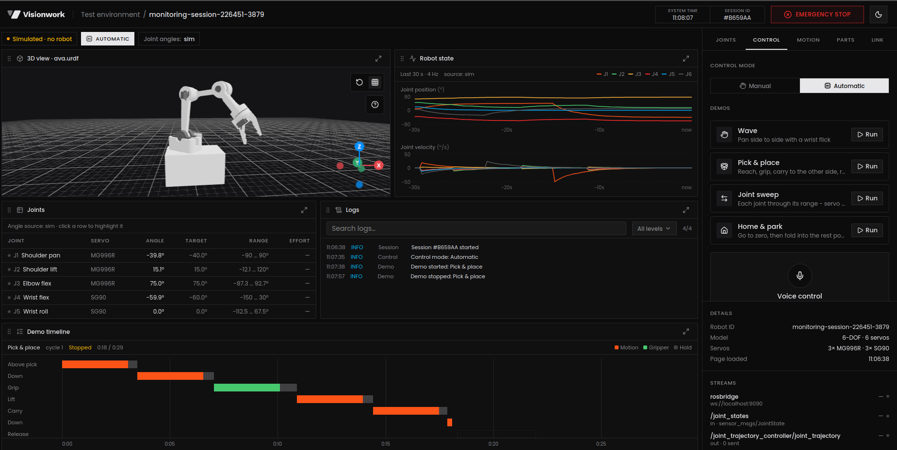

<h1 align="center">◈ &nbsp;A V A &nbsp;◈</h1>

<hr>

<p align="center"><b>web dashboard for a 6-DOF desk arm · live 3D view · ROS 2 over rosbridge</b></p>

<p align="center"><a href="https://github.com/TomasSirotek/ava-dashboard/actions/workflows/ci.yml"></a>&nbsp;<a href="https://github.com/TomasSirotek/ava-arm"></a>&nbsp;&nbsp;&nbsp;</p>

<p align="center"></p>

<p align="center"><sub><i>Screenshot of the work-in-progress dashboard, driving the in-house arm model — UI still evolving.</i></sub></p>

A static Vite + React SPA that talks to ROS 2 over rosbridge (WebSocket), so it
needs no server of its own.

> Status: shows and drives the robot live over rosbridge (Gazebo today, hardware
> later). Without ROS it falls back to a built-in simulation. Still placeholders:
> Solve IK, voice. See [CHANGELOG.md](CHANGELOG.md).

## Features

**Header**: system time, this browser session's ID, emergency **Emergency stop / Release**,
and a light / dark / system theme toggle (dark by default).

**3D viewport**: the robot's real URDF (`public/robot/urdf/ava.urdf`, see
[Run](#run)) posed from the joint state, with orbit controls, a reset-camera button,
a grid toggle, a help popover, and an X/Y/Z axis gizmo in the ROS frame (click an
axis to look along it). Joints picked in the Joints tab are outlined with a
labelled box that tracks them on screen.

**Telemetry panel** on the left, one column with sections separated by hairlines
(the same layout as the tabs panel on the right):

- **Info**: robot ID, model, control mode, then status chips: connection — 🟢 Connected
  (live `/joint_states`), 🟠 No joint data (rosbridge up, no robot), 🟠 Simulated (no
  rosbridge) — online badge, and the control mode (click to open the Control tab)
- **Torque**: effort per joint and servo type, red above 85 %. Only shown while
  `/joint_states` carries effort (Gazebo); the real servos cannot measure it
- **System logs**: timestamped events (session start, rosbridge link, live data, e-stop,
  control mode, gamepad, demos), newest at the bottom

**Sidebar tabs**:

| Tab | What it does |
| --- | --- |
| Joints | Slider and number box per joint (ranges = URDF limits), Home, joint highlight pills, Cartesian target + Solve IK (placeholder) |
| Control | Manual / Automatic (demos: Wave, Pick & place, Joint sweep, Home & park; voice mocked). Controller (gamepad) mode is disabled for now: its code is kept, commented out, marked `Controller mode (disabled)` |
| Motion | Velocity scale and trajectory duration (set how fast slider moves and demos run); acceleration and Simulation/Hardware are not applied yet |
| Parts | The build's hardware, filterable by Servos / Control / Power: photo, role, PCA9685 channel and a folding datasheet. No live readings: the build has no voltage, current or temperature sensors |
| Link | rosbridge WebSocket URL and Connect |

The joint sliders lock while the e-stop is engaged or in Automatic mode. Every action confirms itself with a
toast (sonner, panel-coloured; the icon shows success, info, warning or error).

## Architecture

- **Feature folders.** Code is grouped by feature under `src/features/`, not by
  file type. Everything for one feature sits flat in its folder.
- **State in zustand stores.** Shared state lives in small stores (`*.store.ts`):
  robot telemetry, control mode and e-stop, highlighted joints. Components
  subscribe to single values with selectors, so a telemetry tick only re-renders
  the numbers that changed. Purely local UI state stays in `useState`.
- **Background feeds as hooks.** `app.providers.tsx` runs the hooks that fill the
  stores (the rosbridge feed, the command sender, the demo runner, the gamepad
  watcher) and the theme context.
- **One command path.** Sliders and demos set `commanded` in the robot store.
  With rosbridge it is sent to `/joint_trajectory_controller/joint_trajectory`;
  without it the built-in simulation eases toward it (`robot.store.ts`).
- **Layout separate from content.** `layout/app-layout.tsx` is only the page
  shell (header / viewport / sidebar slots and the toaster). `app/app.tsx` fills
  the slots.
- **Lazy 3D.** three.js loads as its own chunk, so the controls render first.
- **React 19 idioms**: `<Context value>` and `use()`, ref as a prop (no
  `forwardRef`). The one class component is the model's error boundary, which
  React still has no hook for.

## Project structure

```
src/
  main.tsx                  mounts <App />
  index.css                 Tailwind v4 theme tokens (Poppins, dark control-room palette)
  app/                      app root and providers
  layout/                   page shell
  components/
    ui/                     shadcn/ui components (generated, not hand-edited)
    shared/                 Heading, Field, Setting, shared styles
  lib/utils.ts              cn(), firstValue()
  features/
    header/                 header bar: status, link stats, e-stop, GitHub link
    navigation/             sidebar tabs
    joints/                 joint sliders, highlight pills
    target/                 Cartesian target + IK
    control/                control modes, voice settings, gamepad
    motion/                 sim / hardware target, limits
    parts/                  hardware parts catalogue
    connection/             rosbridge URL
    overlay/                left telemetry panel (status, torque when measured)
    logs/                   system log store, event feed and log section
    viewport/               three.js canvas, model, joint tracker, toolbar
    robot/                  robot store, rosbridge feed, command sender
    demos/                  automatic-mode demos and their runner
    theme/                  theme provider and toggle
```

### File naming

Inside a feature folder every file is named after what it holds:

| File | Holds |
| --- | --- |
| `thing.tsx` | a component (kebab-case, one per file) |
| `thing.interface.ts` | types and interfaces, prefixed `I` (`IPart`, `IJointRowProps`) |
| `thing.content.ts(x)` | static data and config: labels, defaults, lists, `useNavItems()` |
| `thing.store.ts` | zustand store and selectors |
| `use-thing.ts` | a hook |
| `thing.context.ts` | a React context |
| `thing.test.ts` | Vitest unit tests for the file next to it (e.g. `robot.store.test.ts` tests `robot.store.ts`) |

Imports always use the `@/` alias (`@/features/parts/parts.content`), never
relative `./` or `../` paths.

## Clone

Standalone:

```bash
git clone git@github.com:TomasSirotek/ava-dashboard.git
cd ava-dashboard
```

Or as part of ava-arm, where it lives at `dashboard/`:

```bash
git clone --recurse-submodules git@github.com:TomasSirotek/ava-arm.git
cd ava-arm/dashboard
```

## Run

Requires Node 22.12+ and pnpm.

```bash
pnpm install
pnpm dev        # dev server at http://localhost:5173
```

The robot model comes from the ROS repo through a symlink (git-ignored), so the
URDF and meshes have one source of truth. Inside ava-arm:

```bash
ln -s ../../ros2_ws/src/ava_description public/robot
```

> `ava.urdf` and the meshes are git-ignored in ava-arm, so the symlink points at files
> that are not in a fresh clone. Without them the viewport falls back to its built-in
> simulation; the rest of the dashboard works. See the
> [ava-arm README](https://github.com/TomasSirotek/ava-arm#the-arm-model-files-are-supplied-locally).

For live data, run rosbridge (`ros2 launch rosbridge_server rosbridge_websocket_launch.xml`,
default `ws://localhost:9090`; override with `VITE_ROSBRIDGE_URL`). See the
[ava-arm README](https://github.com/TomasSirotek/ava-arm#run).

## Scripts

| Script | Does |
| --- | --- |
| `pnpm dev` | dev server |
| `pnpm build` | static output in `dist/` |
| `pnpm preview` | serve the built `dist/` |
| `pnpm typecheck` | TypeScript check |
| `pnpm check` | Biome: lint + format + import order, no changes |
| `pnpm check:fix` | Biome: apply safe fixes and formatting |
| `pnpm test` | Vitest unit tests (`src/**/*.test.ts`), once |
| `pnpm test:watch` | Vitest in watch mode |
| `pnpm test:coverage` | Vitest once with coverage: table in the terminal, HTML in `coverage/` |
| `pnpm lint` | Biome lint only |
| `pnpm format` | Biome format only |

Biome config is in `biome.json`: double quotes, no semicolons, 2-space indent,
140-column lines.

`dist/` works from any static file server, e.g. on a Raspberry Pi:

```bash
cd dist && python3 -m http.server 8080
```

## CI

GitHub Actions ([`.github/workflows/ci.yml`](.github/workflows/ci.yml)) runs on every push to
`main`, on pull requests, weekly (Monday 06:00 UTC, to catch new advisories) and on demand.
The badge at the top shows the latest run on `main`.

| Job | Steps | Fails when |
| --- | --- | --- |
| Dependencies | install with the frozen lockfile, `pnpm audit`, dependency report; on pull requests also GitHub's dependency review | `pnpm-lock.yaml` is out of date, a high or critical advisory has a fixed version, or a PR adds a dependency with a high or critical advisory |
| Lint, typecheck, test, build | `biome ci`, `pnpm typecheck`, `pnpm test`, `pnpm build` | any of them fails (all run, so one run lists every problem) |

Reports: each run's **Summary** page has the Vitest test report, a coverage table and the
dependency report (all advisories, including ones with no fix yet, and outdated packages).
Failing tests and Biome errors show as annotations on the code; the JUnit file and the
HTML coverage report are downloadable as the `test-report` artifact. Coverage has no
minimum: the 3D view and most components are deliberately untested. The ROS contract
tests are skipped in CI, because `public/robot` links into the ava-arm checkout; run
`pnpm test` inside ava-arm to include them.

Also in `.github/`:

- **CodeQL** ([`workflows/codeql.yml`](.github/workflows/codeql.yml)): static security analysis of
  the TypeScript code and the workflow files, same triggers; findings land under
  Security → Code scanning.
- **Dependabot** ([`dependabot.yml`](.github/dependabot.yml)): one grouped pull request a week
  for npm packages and one for the workflow actions, skipping releases younger than 7 days.
  Security-fix PRs are enabled in the repo settings and open as soon as a fix exists.
- **Pinned actions**: every action is pinned to a commit SHA with its version as a comment;
  Dependabot bumps both.
- **Branch protection** ([`rulesets/main.json`](.github/rulesets/main.json), applied in the repo
  settings): `main` takes changes through pull requests that pass both CI jobs; force-push and
  deleting `main` are blocked. Repository admins can bypass (push directly). To change the
  rules, edit the file and apply it with
  `gh api -X PUT repos/TomasSirotek/ava-dashboard/rulesets/<id> --input .github/rulesets/main.json`
  (`gh api repos/TomasSirotek/ava-dashboard/rulesets` lists the id).

Before pushing, the same checks locally: `pnpm check && pnpm typecheck && pnpm test && pnpm build`
(`pnpm test:coverage` for the coverage table).

## Stack

Vite, React 19, TypeScript, Tailwind CSS v4, shadcn/ui (Base UI), three.js /
react-three-fiber / drei, zustand, sonner, lucide-react, roslib, urdf-loader, Biome.
